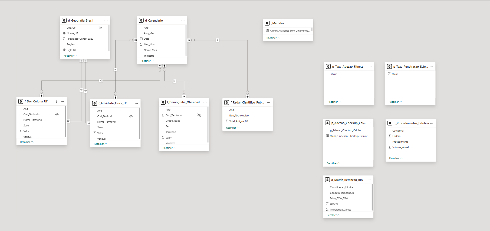
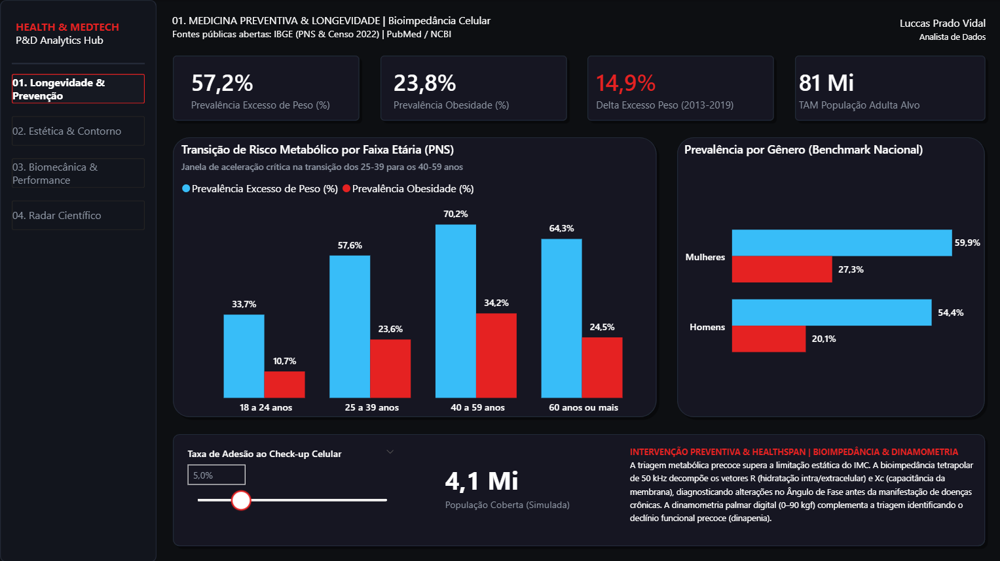
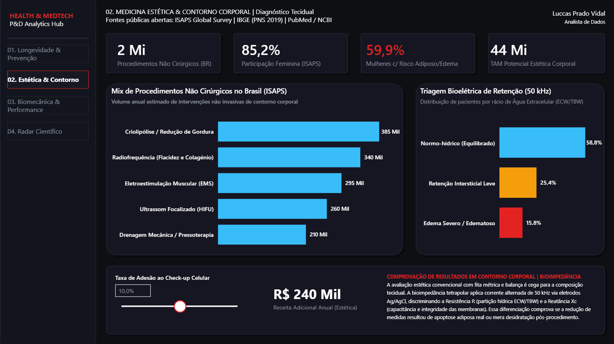
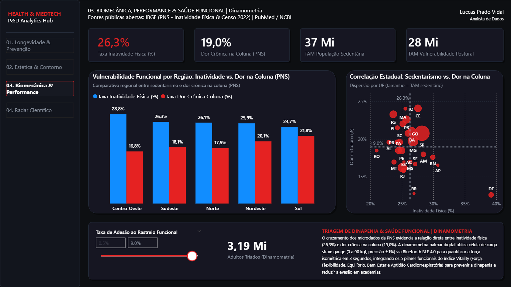
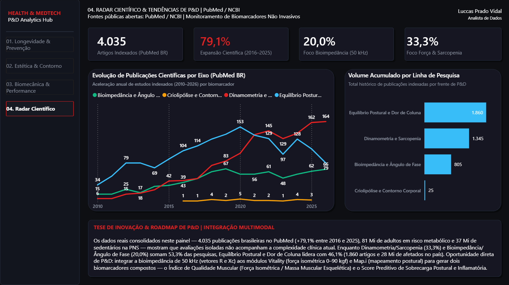

# 🧬 Health & MedTech | P&D Analytics Hub

Painel executivo de **Inteligência de Mercado e Pesquisa & Desenvolvimento (P&D)** desenvolvido em **Power BI**, construído integralmente com bases públicas abertas para mapear gargalos epidemiológicos, dimensionar mercados endereçáveis (TAM) e orientar o roadmap de tecnologias biomédicas não invasivas.

---

## 🎯 Problema de Negócio e Objetivo

Dispositivos de avaliação física e clínica — como analisadores de bioimpedância tetrapolar e dinamómetros digitais — geram métricas fisiológicas valiosas no consultório, mas frequentemente operam de forma isolada. Este projeto responde a uma questão central de P&D:

> *Onde estão os maiores gargalos de saúde preventiva, estética e funcional no Brasil, e como a integração multimodal de biomarcadores pode orientar o desenvolvimento de novas soluções?*

---

## 🗄️ Fontes de Dados Públicas Utilizadas

Todas as métricas históricas e populacionais foram extraídas e tratadas a partir de fontes abertas e auditáveis:

* **IBGE — Pesquisa Nacional de Saúde (PNS 2013–2019):** Prevalência de excesso de peso, obesidade, inatividade física e dor crónica na coluna por faixa etária, sexo e Unidade Federativa (27 UFs).
* **IBGE — Censo Demográfico 2022:** Base populacional adulta utilizada para o cálculo de Mercado Total Endereçável (TAM).
* **ISAPS (International Society of Aesthetic Plastic Surgery):** Benchmarks anuais de volume e perfil demográfico de procedimentos estéticos não cirúrgicos no Brasil.
* **PubMed / NCBI:** Série histórica de **4.035 publicações científicas brasileiras** indexadas por eixo tecnológico e biomarcador.

---

## 🏗️ Arquitetura de Dados (Modelagem Star Schema)

O modelo foi estruturado no esquema estrela (*Star Schema*) para garantir integridade de filtros, escalabilidade e alta performance de cálculo:

* **Tabelas Fato:**
  * `f_Demografia_Obesidade_BR` (indicadores metabólicos por faixa etária e sexo)
  * `f_Atividade_Fisica_UF` (taxas de sedentarismo e atividade física por estado)
  * `f_Dor_Coluna_UF` (incidência de dor crónica na coluna por estado)
  * `f_Radar_Cientifico_PubMed` (volume anual de publicações científicas por eixo)
* **Tabelas Dimensão:**
  * `d_Geografia_Brasil` (27 UFs e 5 macrorregiões)
  * `d_Calendario` (dimensão temporal)
  * `d_Procedimentos_Estetica` (mix de intervenções não invasivas)
  * `d_Matriz_Retencao_BIA` (classificação de partição hídrica `ECW/TBW`)
* **Parâmetros *What-If* & Regras de Negócio:**
  * `p_Adesao_Checkup_Celular`, `p_Taxa_Penetracao_Estetica` e `p_Taxa_Adesao_Fitness`
  * `_Medidas` (tabela dedicada exclusivamente às medidas DAX)



---

## 📊 Visão Geral das Páginas e Insights

### 01. Longevidade & Prevenção
Dimensiona o mercado preventivo em **81 milhões de adultos** (`57,2%` com excesso de peso, `23,8%` com obesidade e expansão de `+14,9%` entre 2013 e 2019), evidenciando a janela crítica de aceleração metabólica na transição dos 25–39 para os 40–59 anos (`70,2%` de excesso de peso). Inclui simulador dinâmico de cobertura populacional para triagem celular via bioimpedância tetrapolar (`50 kHz`).



### 02. Estética & Contorno
Cruza o volume anual de **~2 milhões de procedimentos não cirúrgicos** no Brasil (`85,2%` de participação feminina) com **44 milhões de mulheres** em potencial de atendimento corporal (`59,9%` com risco adiposo/edema). Estratifica a retenção hídrica extracelular (`ECW/TBW`) e projeta o retorno financeiro anual para clínicas conforme a taxa de adesão ao diagnóstico tecidual.



### 03. Biomecânica & Performance
Mapeia os 27 estados brasileiros numa **matriz de dispersão de 4 quadrantes** cruzando inatividade física (média estadual de `26,3%` / `37 Mi` de adultos) e dor crónica na coluna (`19,0%` / `28 Mi` de adultos), isolando mercados prioritários para triagem de dinapenia por dinamometria isométrica (`0–90 kgf`, `±1%`, `BLE 4.0`) e protocolos funcionais multidimensionais.



### 04. Radar Científico & Roadmap de P&D
Consolida **4.035 publicações científicas brasileiras** no PubMed/NCBI (`+79,1%` de expansão entre 2016 e 2025), demonstrando a liderança de *Equilíbrio Postural e Dor de Coluna* (`46,1%` / `1.860` artigos), seguida por *Dinamometria e Sarcopenia* (`33,3%` / `1.345`), *Bioimpedância e Ângulo de Fase* (`20,0%` / `805`) e *Criolipólise e Contorno Corporal* (`0,6%` / `25`).



---

## 💻 Exemplos de Medidas DAX Implementadas

```dax
// Simulador What-If de Cobertura Populacional Funcional
População Triada (Simulado) = 
VAR TaxaAdesao = 
    COALESCE(
        MAX('p_Taxa_Adesao_Fitness'[Value]),
        0.05
    )
RETURN
[TAM População Sedentária (Brasil)] * TaxaAdesao

// Expansão Científica na Última Década Completa (2016–2025)
Crescimento Científico (2016-2025) = 
VAR Artigos2016 = CALCULATE([Total Artigos Publicados], 'f_Radar_Cientifico_PubMed'[Ano] = 2016)
VAR Artigos2025 = CALCULATE([Total Artigos Publicados], 'f_Radar_Cientifico_PubMed'[Ano] = 2025)
RETURN
DIVIDE(Artigos2025 - Artigos2016, Artigos2016, 0)
```

---

## 🚀 Tese de Inovação Gerada pelos Dados (Proposta de P&D)

O cruzamento dos indicadores epidemiológicos e científicos aponta para a superação de avaliações isoladas por meio da **integração multimodal** (bioimpedância tetrapolar a `50 kHz` + dinamometria digital de `0–90 kgf` + mapeamento postural), originando dois biomarcadores compostos:

1. **Índice Composto de Qualidade Muscular:** Razão entre *Força Isométrica (kgf)* e *Massa Muscular Esquelética (kg)* para deteção precoce de dinapenia antes da perda acentuada de massa magra.
2. **Score Preditivo de Sobrecarga Postural e Inflamatória:** Cruzamento do mapeamento biomecânico e equilíbrio com o rácio hídrico extracelular (`ECW/TBW`) para prevenção de dores crónicas na coluna.

---

## 👤 Autor

**Luccas Prado Vidal** — Analista de Dados & Business Intelligence  
Conecte-se no [LinkedIn](https://www.linkedin.com/in/luccas-prado-vidal-972541219/)
